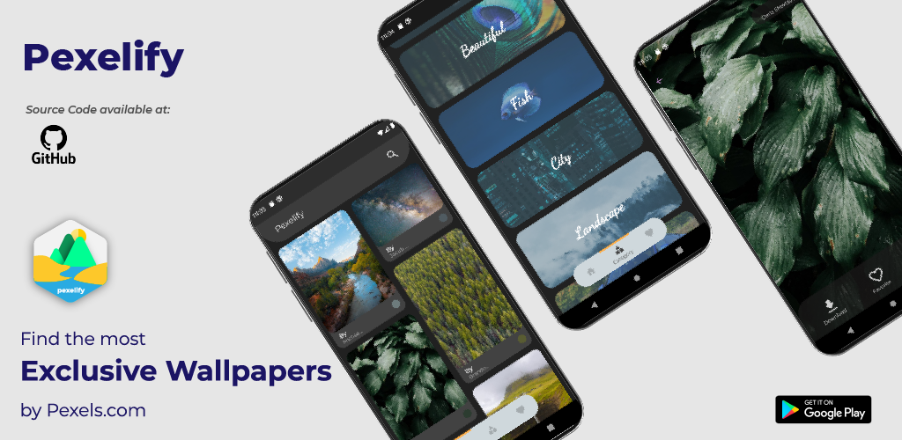

<div align="center">

# 🖼️ Pexelify — Flutter Wallpaper App

**A clean, responsive wallpaper browser powered by the [Pexels](https://www.pexels.com/) photo library.**

[](https://flutter.dev)
[](https://dart.dev)
[](https://dart.dev/null-safety)
[](https://developer.android.com)
[](https://play.google.com/store/apps/details?id=com.ablinfotech.pexelify)

⭐ **Leave a star if you found this repo helpful.**



</div>

---

## ✨ Features

| | |
|---|---|
| 🌊 **Infinite feed** | Masonry grid that pages in fresh wallpapers as you scroll |
| 🔍 **Search** | Find wallpapers by any keyword, straight from the app bar |
| 🗂️ **Categories** | Twelve curated collections — Nature, Beach, Dark, City, and more |
| 🖼️ **Set as wallpaper** | Apply to the home screen, the lock screen, or both |
| ⬇️ **Save to gallery** | One tap saves the full-resolution image to a *Pexelify* album |
| 🌗 **Light & dark themes** | Follows the system theme, with an in-app toggle |
| 📱 **Responsive** | Column counts adapt between phone and tablet layouts |
| 👤 **Photographer credit** | Every card links back to the photographer's Pexels page |

---

## 🚀 Getting Started

### 1. Prerequisites

- Flutter **3.24** or newer (`flutter --version`)
- Android SDK Platform **37** installed
- An Android device or emulator running **API 24+**

### 2. Get a Pexels API key

The app reads the Pexels API key at build time, so it never lives in the
repository. Grab a free key from the [Pexels API dashboard](https://www.pexels.com/api/).

### 3. Run it

```bash
flutter pub get
flutter run --dart-define=PEXELS_API_KEY=your_key_here
```

Building a release APK works the same way:

```bash
flutter build apk --release --dart-define=PEXELS_API_KEY=your_key_here
```

> **Note:** without `--dart-define=PEXELS_API_KEY=...` the app throws a clear
> error on the first request instead of silently showing an empty feed.

---

## 🧱 Project Structure

```
lib/
├── api/         # Pexels HTTP client
├── models/      # PhotosModel, CategoryModel
├── pages/       # home, homepage, category, favorites, search, image detail
├── provider/    # ThemeProvider + light/dark ThemeData
├── utils/       # category seed data, responsive breakpoints
└── widgets/     # ImageCard, theme toggle
```

---

## 📦 Packages

| Package | Purpose |
|---|---|
| [`http`](https://pub.dev/packages/http) | Pexels REST calls |
| [`provider`](https://pub.dev/packages/provider) | Theme state management |
| [`flutter_staggered_grid_view`](https://pub.dev/packages/flutter_staggered_grid_view) | Masonry wallpaper grid |
| [`flutter_snake_navigationbar`](https://pub.dev/packages/flutter_snake_navigationbar) | Animated bottom navigation |
| [`cached_network_image`](https://pub.dev/packages/cached_network_image) | Image loading and caching |
| [`flutter_cache_manager`](https://pub.dev/packages/flutter_cache_manager) | File-level cache for full-size images |
| [`async_wallpaper`](https://pub.dev/packages/async_wallpaper) | Applying home / lock screen wallpapers |
| [`gal`](https://pub.dev/packages/gal) | Saving images to the device gallery |
| [`url_launcher`](https://pub.dev/packages/url_launcher) | Opening photographer profiles |
| [`sign_in_button`](https://pub.dev/packages/sign_in_button) | Google sign-in button styling |
| [`fluttertoast`](https://pub.dev/packages/fluttertoast) | Lightweight status toasts |
| [`hexcolor`](https://pub.dev/packages/hexcolor) | Rendering the Pexels average-colour swatch |

---

## 🤖 Android Configuration

| Setting | Value |
|---|---|
| `compileSdk` | 37 |
| `targetSdk` | 37 |
| `minSdk` | 24 |
| Android Gradle Plugin | 8.13.2 |
| Gradle | 8.14.3 |
| Kotlin | 2.1.0 |
| Java / JVM target | 17 |

Permissions requested: `INTERNET`, `ACCESS_NETWORK_STATE`, `SET_WALLPAPER`.
Saving to the gallery uses the MediaStore, so no storage permission is needed
on Android 10 and above.

---

## 🤝 Contributing

Issues and pull requests are welcome. Please run `flutter analyze` before
opening a PR — the project uses [`flutter_lints`](https://pub.dev/packages/flutter_lints)
and should stay warning-free.

---

<div align="center">

Photos provided by [Pexels](https://www.pexels.com/) · Built with [Flutter](https://flutter.dev)

</div>
